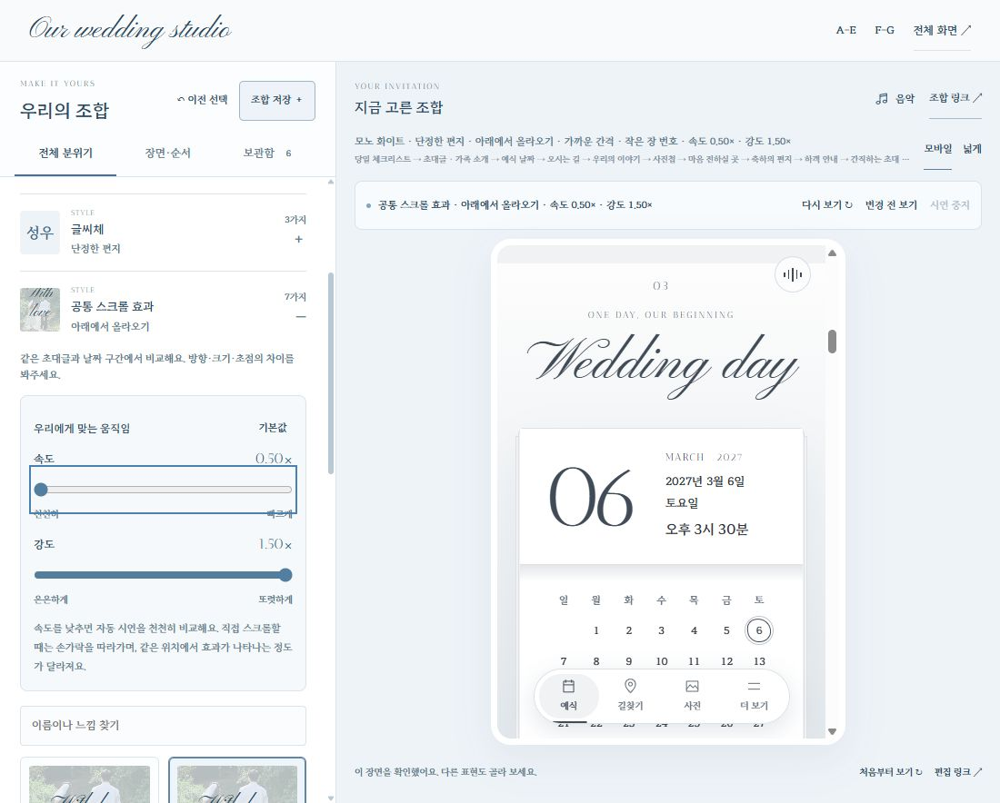

# 속도·강도와 선택 장면 확장 · 2026-10-29

## 사용할 수 있는 것

- **전체 분위기 → 공통 스크롤**: 속도와 강도 각각 0.5–1.5, 0.25 간격. 드래그 중에는 수치만 바뀌고 놓으면 한 번 적용·시연한다. 속도 0.5는 같은 경로를 5.2초 동안 보여 준다. 직접 휠·터치를 느리게 만들거나 잠그지 않고, 스크롤 위치에 따른 효과 진행 곡선을 바꾼다. 강도는 이동 거리·확대·흐림·커튼 농도를 조절한다. 장면 고유 효과만/스크롤 움직임 없이에서는 강도를 비활성화하되 저장값은 유지한다.
- **전체 분위기**: 라일락 안개·모노 화이트를 더해 색감 6종. 읽는 여백 3종, 장면 연결 3종(없음·가는 선·작은 장 번호)을 선택한다. 기존 손글씨·한글 웹폰트·사진·음악은 그대로 사용한다.
- **장면·순서 → 장면 더하기**: 편의 3종(하객 안내·당일 체크리스트·간직하는 초대)과 감성 3종(우리의 약속·우리의 한 문장·감사 인사)을 독립적으로 켠다. 각 장면은 두 가지 표현을 가진다. 기본 7개는 유지하며 추가 장면은 모두 기본 꺼짐이다. 최대 13개를 번호·화살표로 정렬한다. 안내 먼저/사진 먼저/기본 흐름 단축은 추가 장면의 위치를 보존한다.
- **보관함**: 속도·강도·추가 장면·여백·구분·순서를 이름·별점·메모와 함께 저장한다. 기존 version 1 형식과 최대 40개 보관 규칙을 유지한다. URL·개별 JSON·보관함 JSON으로 옮길 수 있으며 기기 간 자동 동기화는 아니다.

## 내용과 정보의 기준

공식 기능 조사 근거는 [조사 기록](extension-research.md)에 정리했다. 하객 안내는 현재 확정된 홀·층·주소·기존 지하철 안내만 표시한다. 주차·식사 등은 `wedding.guestInfo`에 실제 정보가 있을 때만 노출한다. 없는 정보를 예시로 만들지 않는다.

약속과 감사 인사는 편집기에서 제안 초안으로 명시했다. 우리의 한 문장은 소희가 카페를 운영하는 모습을 보고 함께라면 무엇이든 할 수 있겠다고 느꼈다는 사용자의 설명을 의역했다. 소희의 발언이나 새 에피소드를 만들지 않는다. 본문이 길어지는 것을 피하려면 여섯 개를 모두 쓰기보다 필요한 장면만 고른다. RSVP·별도 두 번째 앨범은 추가하지 않았다.

## 상태와 안전 경계

새 선택은 additive version 1 필드이며 예전 URL·저장은 1배/기본 여백/구분 없음/추가 장면 없음으로 열린다. `extras`에 명시된 허용 ID만 활성화하고 order만으로는 선택 장면을 켤 수 없다. 숫자·배열·선택 값은 모두 정규화하며 데이터 모드와 API 주소는 받지 않는다.

기존 미리보기·음악·체크박스·질문·방명록 노드를 유지한다. 카드형 하객 안내는 답변을 펼쳐 놓고, 접는 형식으로 돌아가면 원래 열린 질문 상태를 복원한다. 시연이 저장·복사·외부 이동을 실행하지 않는다. 창 열림·직접 입력·숨김·효과 끄기·모션 감소에 대한 시연 취소를 유지한다. 숨겨진 추가 장면은 시연 정리 때 읽은 것으로 처리하지 않는다.

## 확인한 결과

- 전체 `npm run check`: **2,244개 통과**. 각 속도·강도 조합과 64가지 추가 장면 조합의 URL/저장 왕복, 기존 조합의 기본값, 허용값·경계·실행 취소·상태 보존을 검사했다.
- 실제 브라우저: 0.5배/1.5강도 적용·변경 전 비교·되돌리기·빠른 연속 선택, 여섯 장면 추가와 체크리스트 첫 순서 이동, 체크 유지, 카드형 안내 전체 답변 노출, 안내 이미지 생성 연결을 확인했다.
- 실제 보관함에 별점 5·메모를 가진 로컬 확인 조합을 저장했다. 이전 저장 조합을 불러왔을 때 추가 장면이 꺼지고 1배로 열리며, 새 조합을 다시 불러오면 여섯 장면·세부 설정·순서가 복원됐다. 파일 형식 왕복은 자동 검사로 확인했다.
- 조합 변경 전후 음악은 **9.187 → 9.292초**, 재생 상태를 유지했다. 직접 정지 상태도 유지한다. 작성 중인 메시지와 열린 작성창은 그대로 남고 시연은 차단된다. 메시지는 제출하지 않았다.
- 320/390/430/1100/1440px에서 편집기와 미리보기의 가로 넘침 없음. 속도·강도 입력은 높이 44px. 이는 데스크톱 브라우저 크기 검사이며 실제 휴대폰의 OS 공유·지도 앱·터치 품질을 대신하지 않는다.
- IAB에서 이전 검사와 같은 소스 위치 없는 `MutationObserver.observe` 오류가 기록됐다. 이번 선택·상태 보존 기능 실패는 재현되지 않았으나 콘솔 오류 0으로 보고하지 않는다. 이미지 저장은 브라우저가 공유 완료를 반환한 것을 확인한 범위이며 실제 휴대폰 파일 저장 위치는 별도 확인이다.
- 전용 빌드/업로드 목록 **256개**가 경로와 SHA-1까지 일치한다. 배포는 조립실 변경과 필요한 네 자산만 추가하며, 기존 **205개 배포 파일**의 바이트 보존 검사를 통과했다. 운영 API·회원 권한·실제 계좌·사진·방명록은 변경하지 않았다.

다음: 두 분이 추가 장면을 1–2개 골라 길이와 문구를 확인하고, 확정된 주차·식사 정보를 넣는다. 마음에 드는 조합의 운영 적용은 별도 단계다.

## 공개 반영

Vercel `dpl_Bu8cAGkCPNAEYZskhnwqRhCCpMfg`가 READY이며 `https://sungso-wedding.vercel.app/lab/studio/`에서 반영을 확인했다. 공개 제공 파일 254개가 로컬 빌드와 일치한다. 제외 경로 50개는 404, 기존 API 경계 19개와 GitHub Pages 파일 4개의 보존을 확인했다. 운영 검증 쓰기는 0회다. 공개 화면에서 속도·강도와 새 선택 목록을 다시 확인했다. 상세 자동 결과는 `live-check.json`이다.
