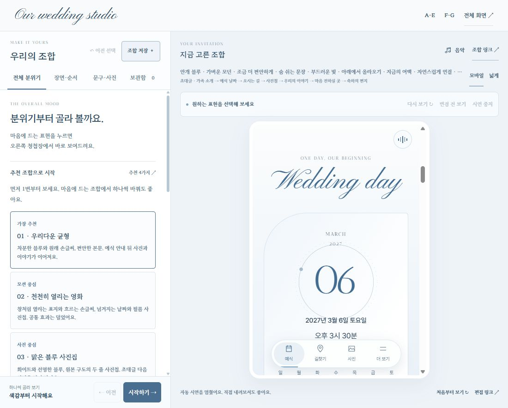
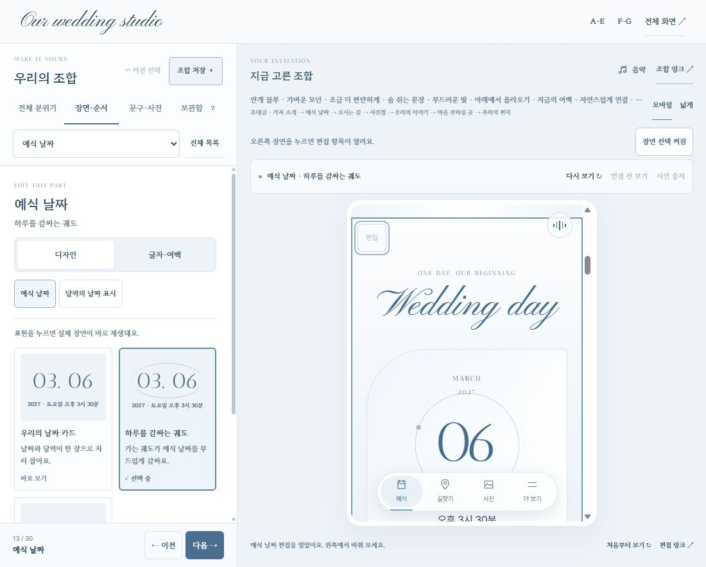
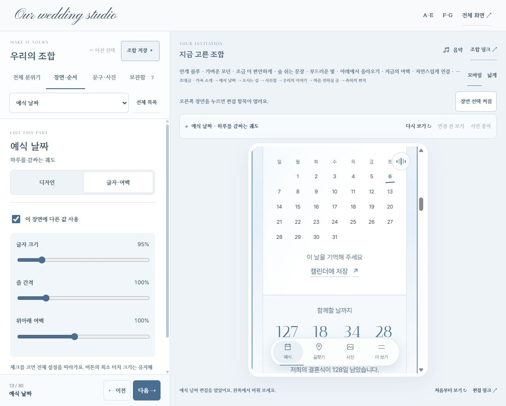

# 화면에서 고르는 장면 편집 — 2026-10-29

사용자가 표시한 예식 날짜와 왼쪽 편집 목록을 기준으로, 현재 보이는 장면에서 해당 설정을 바로 찾는 흐름으로 바꿨다. 청첩장 자체의 디자인·자료와 운영 기능은 그대로 두고 조립실의 탐색을 개선했다.

## 확인한 문제와 변경

| 단계 | 화면에서 확인한 문제 | 반영한 동작 |
| --- | --- | --- |
| 수정할 곳 찾기 | 오른쪽에 Wedding day가 보이는데 왼쪽은 추천 조합이나 보관함이다. 장면과 설정의 연결이 없다. | 장면의 글자·빈 곳 또는 작은 편집 버튼을 누르면 해당 편집 항목을 연다. 선택한 장면에 얇은 외곽선을 표시한다. |
| 설정 고르기 | 추천 카드가 첫 화면을 차지하고 설정을 찾기 위해 긴 목록을 내려야 한다. | 추천은 기본 접힘. 항상 보이는 ‘편집할 항목 바로 찾기’와 ‘전체 목록’으로 이동한다. 선택한 항목만 왼쪽에 펼친다. |
| 세부 편집 | 날짜·달력·글자 크기가 떨어져 있어 찾기 어렵다. | 선택한 장면 안에 디자인 / 글자·여백 / 지원하는 문구·사진 편집을 모은다. 날짜에는 달력, 표지에는 손글씨·구도, 사진첩에는 배열 설정을 연결한다. |
| 계속 작업 | 오른쪽을 고를 때 읽던 위치가 이동하거나 다른 버튼 동작을 막을 수 있다. | 장면 선택만으로 조합/URL을 바꾸거나 재시연·초점·스크롤 이동을 하지 않는다. 실제 링크·사진·음악·폼 조작은 그대로 동작한다. |

## 구현 경계

- 부모가 명시적으로 켠 동일 출처의 내장 비교 iframe에서만 편집 버튼과 선택 수신기를 설치한다. 독립 미리보기에는 버튼이 없다. 부모·자식 모두 정확한 창/출처를 확인하고 고정된 장면 ID만 받는다.
- 드래그·세로 스크롤·선택한 텍스트·열린 모달을 장면 선택으로 처리하지 않는다. 키보드 Enter로 편집 버튼을 사용할 수 있다. 장면 선택은 도구 막대에서 끌 수 있다.
- 전체 분위기는 전체에, 장면별 글자/여백은 해당 장면에 적용하는 기존 모델을 유지한다. 편집 탭·선택 표시를 조합 스키마나 공유 URL에 추가하지 않았다.
- 디자인/세부 탭을 빠르게 바꿔도 준비 중인 장면 도착을 취소하지 않는다. 직접 미리보기를 선택하거나 스크롤하면 기존 시연 취소 동작이 우선한다.
- Undo/조합 불러오기로 사진첩 열 설정을 쓸 수 없는 배열이 되면 사진첩 디자인으로 돌아온다. 비활성화된 추가 장면을 편집 중이었다면 전체 목록을 다시 표시한다.
- 보관함 이름·별점·메모, 문구/사진 로컬 초안과 기존 저장 형식, 음악 재생 위치, 실제 관리 권한을 유지한다. 문구·사진은 기존 초안/관리 흐름을 연결하며 새로운 운영 DB 쓰기는 없다.

## 검증

- 전체 `npm run check`: **2,339개 통과**. 새 검사는 실제 부모 메시지 처리, 장면 매핑·출처·허용 목록, 클릭/드래그/키보드, 세부 탭의 준비 상태와 Undo 후 빈 화면 회귀를 포함한다.
- 320/390/430/1100/1440px에서 바깥 화면과 iframe 가로 넘침 0, 다음 버튼 높이 44px 확인. 모바일에서는 상단 안내를 줄여 미리보기와 접을 수 있는 편집 패널을 함께 남긴다. 실제 휴대폰 터치 검증은 별도다.
- 예식 날짜·사진첩·내용 편집/전체 목록·관련 달력 설정·다음 단계 이동 확인. 키보드 Enter로 예식 날짜 편집 진입 확인.
- 실제 좌표로 장면을 누르기 전후 내부 scrollTop **965 → 965**, 조합 URL 유지 확인. locator 자동 스크롤 결과와 구분했다.
- 보관함에서 쓰던 이름 유지, 같은 음악이 0.58 → 16.06초로 계속 재생됨을 확인한 뒤 정지했다. 검증용 이름은 저장하지 않고 비웠다.
- 장면 선택을 끄면 본문을 눌러도 편집기가 바뀌지 않는다. 사진 확대와 일정 저장 창 열기/닫기는 그대로 작동한다. 독립 미리보기 편집 버튼 0개 확인.
- 로컬 IAB 초기 진입에서 출처 없는 MutationObserver 오류 1건이 관측됐으나 기능 실패는 재현되지 않았다. 전체 로컬 실행을 ‘오류 0’으로 기록하지 않는다. 공개 최종 검증은 배포 기록에 따로 남긴다.
- 빌드 275개 허용 파일. 스튜디오 이전 배포 기준 파일 205개 보존 검사 통과. 운영 API·인증·Firebase·실제 계좌·방명록·사진 값은 변경하지 않았다.

## 다음

두 사람이 실제로 장면을 고르며 디자인·세부·문구 이동이 자연스러운지 확인한다. 선택 조합의 운영 승격은 별도 완료본으로 진행한다.
