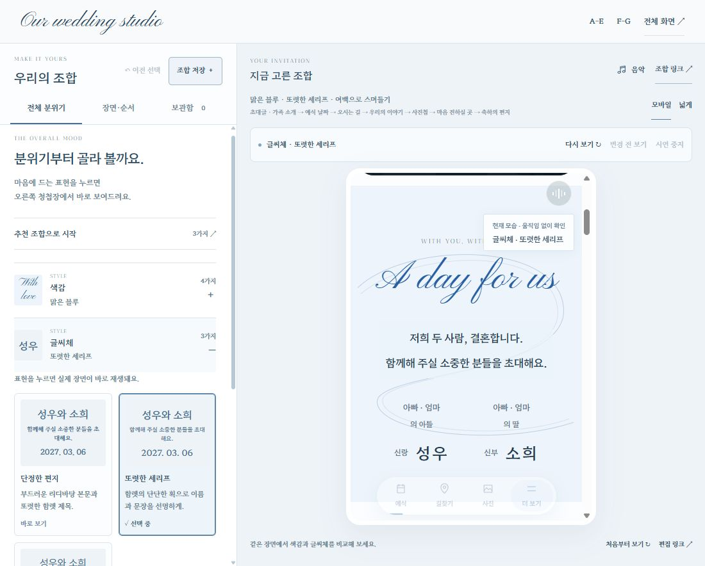
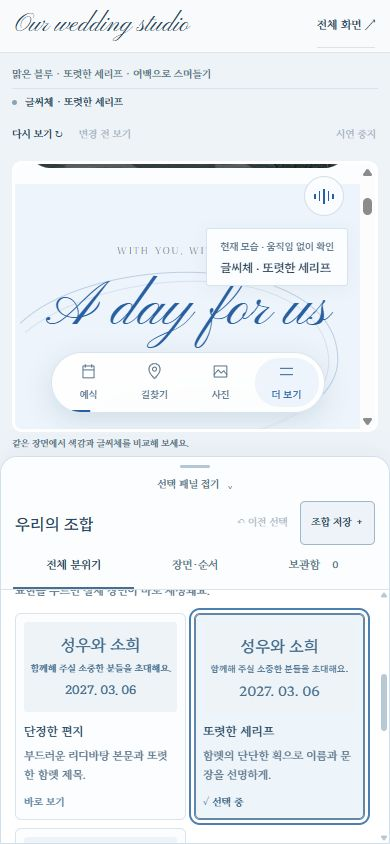

# 2026-10-29 — 고르는 즉시 차이가 보이는 청첩장 조립실

## 구현 범위

승인한 계획에 따라 `/lab/studio/`의 선택·비교 흐름을 개편했다. 왼쪽에서 표현을 한 번 고르면 같은 미리보기 문서에 즉시 적용하고, 준비된 실제 장면으로 이동해 약 2~4초 동안 한 번 시연한다. 기존 운영 청첩장의 디자인·데이터·관리 권한은 변경하지 않는다.

- 왼쪽을 **전체 분위기 / 장면·순서 / 보관함** 세 탭으로 나눴다. 추천 조합은 접힌 시작 영역에 둔다.
- 옵션은 왼쪽 안에서 한 항목씩 펼친다. 별도 선택 모달과 추가 적용 버튼을 제거하고 실제 사진·서체, 표현 이름, 차이를 설명하는 문장으로 비교한다.
- 여섯 개를 넘는 선택지에는 검색과 더 보기를 제공한다. 다른 항목은 현재 선택을 요약하며 편집 패널의 스크롤 위치·키보드 초점을 유지한다.
- 장면은 현재 청첩장 순서대로 표시한다. 표지·첫 손글씨는 맨 위, 빠른 메뉴는 별도 항목이며 순서 조작은 ‘순서 편집’에서만 보인다.
- 상단의 ‘이전 선택으로’와 ‘조합 저장’을 유지한다. 저장은 기존 보관함 폼으로 연결하고 작성 중인 이름·메모·별점을 보존한다.
- 오른쪽에 바뀐 항목과 시연 상태, **다시 보기 / 변경 전·현재 비교 / 시연 중지**를 제공한다.
- 모바일에서는 미리보기와 접을 수 있는 하단 편집 패널을 함께 제공한다. 옵션을 선택할 때 별도 편집·미리보기 화면으로 전환하지 않는다.

## 항목별 실제 시연

| 선택 항목 | 미리보기 동작 |
| --- | --- |
| 색감·글씨체 | 같은 초대글 위치에서 선택한 색과 실제 서체를 정적으로 비교한다. |
| 공통 스크롤 | 같은 초대글 진입 구간에서 다음 장면까지 동일한 경로·시간으로 이동한다. 일곱 표현의 기존 장면 유지·추가 효과·스크롤 효과 없음이 구분된다. |
| 표지 | 표지 시작부터 펼침·축소 등 해당 스크롤 연출을 재생한다. |
| 첫 손글씨 | 현재 표지에서 기존 실제 획 애니메이션을 선택한 표현으로 다시 재생한다. 편집기 시연은 스크롤을 잠그지 않는다. |
| 초대글·날짜·이야기 | 해당 장면의 진입과 실제 스크롤 효과를 보여준다. 이야기 창은 열지 않는다. |
| 사진첩 | 배열 등장 후 다음 사진으로 한 번 전환한다. 격자에서는 두 번째 실제 사진을 강조하며 확대 창을 열지 않는다. |
| 오시는 길 | 약도 진입과 교통 안내 전환을 보여준다. 외부 지도는 열지 않는다. |
| 마음 전하실 곳 | 예시 받는 분을 한 번 바꿔 카드 전환을 보여준다. 복사·송금을 실행하지 않는다. |
| 축하의 편지 | 봉투·엽서·노트의 열림 표현까지만 시연한다. 작성 창을 열거나 입력·제출·초점 이동을 하지 않는다. |
| 빠른 메뉴 | 짧은 구간을 스크롤해 현재 읽는 위치 표시가 바뀌는 모습을 보여준다. |

시연용 사진·교통편·받는 분 선택은 종료·취소 시 원래 상태로 복원한다. 실제 사용자 입력은 캡처 단계에서 시연을 먼저 취소하므로 이어지는 사용자 선택이 우선한다. 자동 반복이나 휠 가로채기는 없다.

## 요청 처리와 상태 보존

- `apply → applied → demo → complete/cancelled` 단계에 요청 ID를 연결했다. 부모는 요청 ID와 적용된 조합을 모두 확인한 뒤 한 번만 시연을 요청한다. 자식은 최신 요청만 실행하며 이전 폰트·이미지 응답이나 취소한 요청이 시연을 되살리지 못한다.
- 새 선택은 이전 요청 ID의 시연을 멈춘 후 새 ID로 적용한다. 준비 중 직접 조작이나 명시적 중지는 같은 ID의 뒤늦은 재생도 차단한다.
- 메시지의 동일 출처·정확한 부모 창·허용된 시각 선택 항목 검사를 유지한다. 편집기 시연은 내장 미리보기에서만 실행되며 독립 하객용 화면에는 등록하지 않는다.
- ‘변경 전’은 마지막 변경 항목 하나만 임시 적용한다. 저장할 현재 조합, 부모 URL, 미리보기의 실제 공유 주소·일정 링크는 바꾸지 않는다. 현재 선택으로 돌아오거나 저장·공유할 때 현재 조합을 유지한다.
- 미리보기 iframe, 오디오 요소, 계좌·사진첩·방명록 컨트롤러를 다시 만들지 않는다. 열린 작성 창과 초안, 기존 사진·교통편·받는 분 선택을 유지한다. 순서 변경 메시지도 열린 창을 강제로 닫지 않는다.
- 휠·터치·키보드 입력, 새 선택, 탭 숨김, 팝업 열림에 시연을 취소한다. 왼쪽 편집 패널의 휠·터치·키보드 조작도 준비·재생 중 시연을 멈춘다.
- 시스템 모션 감소 또는 화면 효과 끄기에서는 읽을 수 있는 정적 결과와 설명을 보여준다. 설정을 강제로 켜지 않으며 숨은 본문이나 지속 프레임 루프를 남기지 않는다.

기존 V1 조합 스키마·공유 URL·JSON 형식·보관함 저장 키와 최대 40개 제한을 유지한다. 이름·별점·메모·검색·불러오기·파일 내보내기를 유지하며 탭·검색·펼침·시연 상태는 조합에 저장하지 않는다. 보관함은 해당 브라우저의 로컬 저장이며 기기 간 자동 동기화는 아니다.

조립실은 기존과 같이 예시 계좌와 별도 로컬 체험 방명록을 사용한다. 운영 API·Firebase 설정·관리 인증·실제 계좌·방명록 자료에는 쓰지 않는다. 기존 `/`, `/v6/`, A–E, F/G 배포 파일 205개의 해시 보존 검사를 유지하고 변경·추가 배포 범위를 `/lab/studio/`로 제한한다. 이번 추가 런타임 파일은 시연 컨트롤러와 그 스타일이며 전용 빌드의 허용 파일 수 상한은 252개다.

## 자동 검사

- 전체 검사 **2,213개 통과**, Studio 검사 **123개 통과**.
- 실제 catalog 요청·ACK 처리와 app 적용·시연 메시지 코드를 실행하는 회귀 검사로 이전 요청 정지/새 요청 적용 순서, 중복 ACK, 빠른 연속 선택, 늦은 폰트 준비, 잘못된 조합 ACK, 준비 중 취소, 임시 비교를 확인했다.
- 13개 항목의 제한된 시연 경로, 늦은 준비 응답 취소, 직접 입력 우선, 이미지 지연, 팝업·숨은 탭·모션 감소, 안전한 정리를 검사했다.
- 기존 장면 컨트롤러의 실제 시연 진입점으로 사진·교통편·받는 분 상태 복원, 사용자 선택 우선, 방명록 초안 보존, 복사·제출·외부 이동 미실행을 검사했다.
- 기존 URL·저장 조합·별점·메모·JSON 왕복·본문 순서·손글씨·모션 비활성 회귀 검사를 통과했다. 모든 선택과 순서의 교차곱을 실제 브라우저에서 시험했다는 의미는 아니다.

## 실제 브라우저 확인

주 작업 에이전트가 로컬 브라우저에서 다음을 확인했다.

- 13개 선택 항목을 각각 적용하고 대상 장면으로 이동·시연되는 흐름을 확인했다. 공통 스크롤 일곱 종류는 같은 구간으로 비교했고 음악 시간이 약 22초에서 39초로 이어졌다.
- ‘변경 전’을 보는 동안 현재 선택과 URL이 유지됐다. 작성 중인 방명록은 옵션 변경과 본문 순서 변경 후에도 열린 상태와 초안을 유지했다.
- 저장 폼에 작성한 이름·메모·별 다섯 개가 탭 왕복 후 유지됐으며 새 조합을 로컬 보관함에 저장했다. 운영 저장은 하지 않았다.
- 같은 오디오의 재생이 약 122초까지 이어졌다. 선택 시 음악 재시작이나 새 플레이어 생성이 없었다.
- 키보드로 다시 보기를 실행한 뒤 준비 중 중지하면 `cancelled`로 끝났다. `rise → focus → breathe`의 빠른 연속 선택에서는 마지막 `breathe`가 반영됐다.

| 화면 폭 | 구분 | 가로 넘침 | 펼친 패널 상태의 미리보기 높이 |
| --- | --- | --- | --- |
| 320px | 모바일 | 0 | 약 208px |
| 390px | 모바일 | 0 | 약 264px |
| 430px | 모바일 | 0 | 약 321px |
| 1100px | PC | 0 | 약 543px |
| 1440px | PC | 0 | 약 659px |

모바일 하단 패널을 접었을 때는 미리보기 높이 약 565px를 확인했다. 위 높이는 검수 당시 브라우저 뷰포트에서 측정한 값이며 기기 높이·브라우저 도구 영역에 따라 달라진다.

## 독립 검토와 한계

별도 읽기 전용 코드 검토에서 요청 취소·비교 URL·음악 연속성·live DOM 보존·모션 감소 처리를 확인했다. 검토 중 발견한 새 요청 ID를 미리 중지하던 문제는 이전 ID를 중지하도록 수정하고 회귀 검사했다. 순서 변경 시 열린 방명록을 닫던 경로도 팝업 보호 조건으로 수정했다. 최종 검토에서 추가 수정이 필요한 고신뢰 결함은 찾지 못했다.

IAB 검사 중 이전 버전에서도 관측된, 소스 위치가 없는 `MutationObserver.observe`의 `parameter 1 is not of type Node` 오류가 기록됐다. 이번 검증 결과를 **콘솔 오류 0**으로 표현하지 않는다. 실제 휴대전화의 터치 품질·성능·OS 공유 시트·지도 앱 실행·은행 앱 붙여넣기는 이번 데스크톱 브라우저 검사로 검증한 범위가 아니다.

## 공개 배포 기록

Vercel `dpl_BcbCKAJun4B8FLofVHNLoSvCBfHs`가 READY이며 [공개 조립실](https://sungso-wedding.vercel.app/lab/studio/)에 연결됐다. 허용 목록 252개 경로와 실제 업로드 SHA1을 대조했다. 빌드 시 기존 205개 파일의 바이트 보존을 확인했다.

최종 익명 공개 검사는 제공 파일 **250개 일치**, 다른 앱·내부 경로 **50개 HTTP 404**, API 허용/거부 **19개**, GitHub Pages 주요 파일 **4개 보존**으로 통과했다. 운영 쓰기는 **0회**다. 세부 응답은 [live-check.json](live-check.json)에 보관했다.

공개 화면에서 새 세 탭, 한 번 선택한 스크롤 효과의 준비→완료, 이전 선택 복원과 색감·글씨체 정적 비교를 확인했다. 사용자가 보고 있던 원래 조합은 복원했고 공개 보관함에는 검증 조합을 저장하지 않았다. 최소44px 터치 영역 수정과 안내 문구 보완 후 실제 앱 메시지 처리 회귀 5개와 전용 빌드를 다시 통과했다.

**다음:** 두 사람이 조합을 별점·메모와 함께 저장해 비교하고 실제 휴대폰에서 최종 구성을 확인한다.
