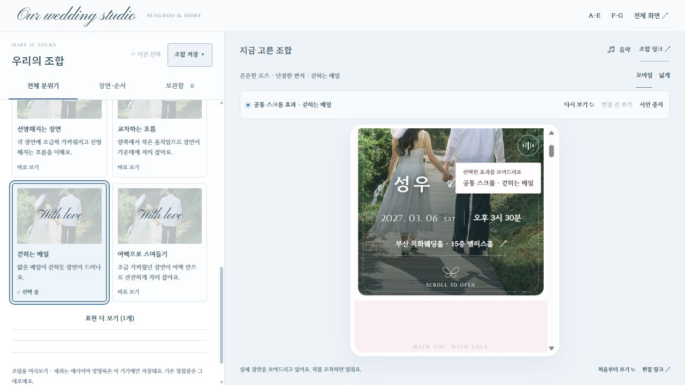
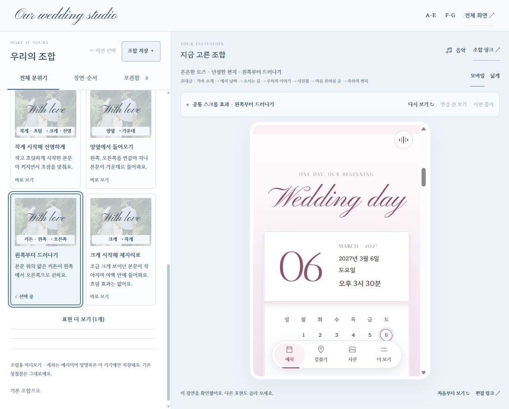

# 스크롤 효과 구분 보완 — 2026-10-29

사용자 피드백: “스크롤효과는 뭐가 다른지 모르겠어.” 현재 공개 화면을 실제로 열고 시연 전후의 화면과 DOM 상태를 대조했다. 기존 디자인 안에서 모션과 비교 안내만 보완했다.

## 발견과 수정

1. **선택: 구분이 약함.** 기존 공통 모션은 이동16~18px, 확대2%, 축소3.5%, 흐림1.2px여서 장면 고유 연출에 묻히기 쉬웠다. 이름도 방향을 설명하지 않았다. 이름·한 줄 설명·실사진 샘플의 방향표시를 구체화하고 키보드 초점에도 샘플 모션이 보이게 했다.
2. **시연 뒤 직접 스크롤: 결함 확인.** `prepareDemo()` 정리가 모든 섹션의 단조 진행값을1로 덮어썼다. 공개 화면에서 시연 완료 후 아래 사진첩 top2894px인데도 opacity1/wipe100%였다. 화면에 보이거나 지나간 내용만 정리하고 아래 미방문 구간의 이전 진행값은 복원하도록 고쳤다.
3. **수정 후: 회귀 확인.** 공개 화면의 같은 미방문 사진첩은 opacity.68/wipe0%다. 로컬 실제 PageDown에서 아래 사진첩 x−44→−27.824→0px, opacity.68→.797→1로 변해 직접 스크롤에도 모션이 이어진다.

| 표시 이름 | 실제 차이 |
| --- | --- |
| 장면 고유 효과만 | 기존 리본·날짜 넘김 등만 사용 |
| 아래에서 올라오기 | 세로44px→0, 크기·초점 변화 없음 |
| 작게 시작해 선명하게 | .90→1 확대, blur3.5px→0 |
| 양옆에서 들어오기 | 섹션마다 좌우 교대, ±44px→0 |
| 왼쪽부터 드러나기 | 장식 베일이 왼쪽부터 걷힘; 본문·초점 영역은 자르지 않음 |
| 크게 시작해 제자리로 | 1.09→1 축소, 흐림 없음 |
| 스크롤 움직임 없이 | 스크롤 모션 중지, 손글씨·클릭 기능 유지 |

기존 composition ID와 URL·보관함은 유지한다. 새 공통 모션의 기본 밝기는 .68이며 읽은 내용은 다시 흐려지지 않는다. 모션 감소·효과 끄기·초점 진입·시연 중지는 보존한다. 커튼은 pointer-events:none인 장식에만 적용한다.

## 검증

- Studio125개, 전체2,215개 검사 통과. 미방문 장면의 후속 스크롤과 효과 끄기 후 복원 회귀2개를 추가했다.
- 실제 선택 직후 computed style: 초점 효과 scale.9096/blur3.1627px/translate:none, 좌우 효과 translate−39.7596px/scale:none/filter:none, 커튼 opacity.6506/left-inset9.637%, 줌아웃 scale1.0813/filter:none으로 독립 차이를 확인했다.
- 320px 편집기 및 내장 미리보기 가로 넘침0. 실제 휴대폰의 성능·터치감까지 검증한 것은 아니다. 정적 캡처만으로 모션 품질을 판단하지 않고 같은 컨트롤의 실제 시연과 상태 변화를 함께 확인했다.
- Vercel `dpl_Q4JCaQyFPxVcRJerHuGMQr9LGJS8` READY. 252개 허용 경로/SHA1 일치, 기존205개 파일 보존. 운영 데이터·API·권한 변경은 없다.
- 최종 공개 검사: 제공250개 파일 일치, 제외50개 경로404, API19개 허용/거부, 기존 Pages4개 보존, 운영쓰기0. 응답 기록은 `live-check.json`에 보관한다.

**다음:** 두 사람이 같은 구간에서 비교하고 원하는 움직임을 조합에 저장한다.
