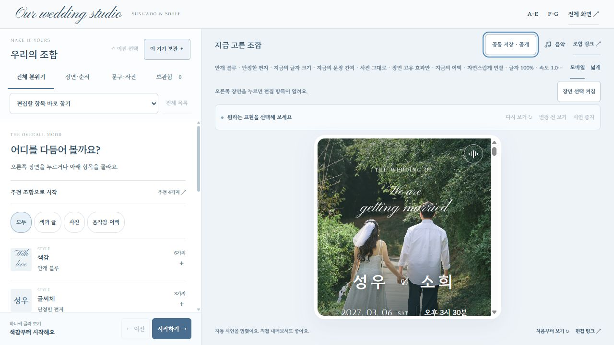
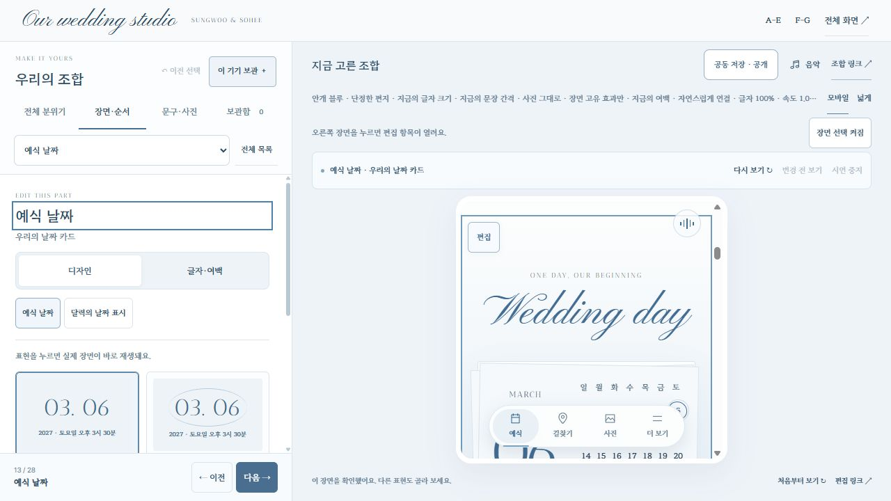

# 청첩장 Studio V2 분석과 구현 계획

2026년 10월 31일 기준. 이번 범위는 첨부 명세 분석과 구현 계획이며, 앱 구현·배포·운영 데이터 변경은 포함하지 않는다.

**Studio V2는 구현할 수 있다. 우선 장면 목록과 미리보기를 보면서 한곳에서 편집하는 화면을 만들고, 하객용 신규 기능은 별도 단계로 추가하는 구성이 적합하다.** 기존 Studio V1, 손글씨, 음악, 사진첩, 계좌·방명록 서버, 두 회원의 관리 권한, 공동 저장과 명시적 공개 흐름을 유지한다.

분석 대상은 사용자가 첨부한 `studio-upgrade-spec.md`, 현재 보호된 `/lab/studio/` 화면과 작업 브랜치 `codex/invitation-publishing`의 `0dc574e` 소스다. 여기서 말하는 **Studio V2는 편집기 버전**이며, 과거 청첩장 VER2나 저장 형식의 버전 2와 구분한다.

## 1. 현재 화면에서 확인한 문제

| 순서 | 확인한 흐름 | 상태와 근거 | V2에서 해결할 내용 |
| --- | --- | --- | --- |
| 1 | 기본 편집 화면 열기 | 개선 필요. 1280×720 화면에서 휴대폰 미리보기 영역은 높이 384px, 너비 390px였다. 여러 안내·도구 줄이 위아래를 차지한다. | 미리보기 도구를 한 줄로 줄이고 안내는 상태 표시로 합친다. |
| 2 | 항목 바로 찾기에서 예식 날짜 선택 | 부분 양호. 날짜 설정과 장면 연결은 작동하지만, 다른 장면 선택 목록이 사라져 전체 구성을 보면서 이동하기 어렵다. 디자인·글자/여백·내용을 찾는 경로도 분리돼 있다. | 장면 목록은 계속 보이고 선택한 장면의 설정만 오른쪽에서 바꾼다. |

### 1단계 기본 편집 화면



### 2단계 날짜 장면 선택



이 두 화면은 이번 분석에서 직접 확인한 캡처다. 모바일 실기기, 모든 옵션 조합, 접근성 전체 준수와 프레임 성능은 이번 분석의 검증 결과가 아니다. 아래 반응형 수치와 동작은 V2 구현 목표다.

소스에서도 관련 원인을 확인했다.

- `catalog/catalog.mjs`의 `syncChoiceVisibility()`가 집중 편집 중 선택하지 않은 옵션 행을 숨긴다. 단순히 접힌 상태와 다르다.
- `apply()`는 변경한 항목의 `SECTION_IDS`를 시연 대상으로 잡는다. 색감·글씨체처럼 전체에 적용되는 설정도 특정 장면 이동으로 이어질 수 있다.
- 현재 변경 전 비교는 마지막 변경 항목 하나를 중심으로 한다. 이름·문구·사진까지 포함한 조합 전체 비교는 아니다.
- 순서 변경에는 위치 선택과 위·아래 이동이 있다. 드래그만 더하기보다 현재 키보드 대안을 유지하는 것이 중요하다.

## 2. 첨부 명세에서 조정할 부분

| 명세의 제안 또는 전제 | 분석 결과와 채택 방향 |
| --- | --- |
| 앞부분의 2열 아코디언과 뒷부분의 3열 편집기 | 서로 다른 대안이다. 두 구조를 모두 쌓지 않는다. 3열을 PC 기본으로 택하고, 간결한 도구·작은 옵션·읽던 위치 유지 원칙을 앞부분에서 가져온다. |
| 기존 코드 90% 재사용, 저장 형식과 메시지 계약 유지 | 재사용률은 산정되지 않았다. 기존 장면·음악·인증 코드는 활용할 수 있지만, 장면 숨김·영상·직접 문구 편집·새 데이터 저장은 계약 확장이 필요하다. |
| 신규 기능 총 15종 | 뒤에 실용 안내 8항목과 추가 아이디어 8항목, 별도 장면 키가 더 붙는다. 전체를 한 번의 편집 화면 개편으로 취급하면 범위가 크게 늘어난다. |
| 부모 이름이 고정되어 있음 | 현재 내용 스키마에 양가 부모 이름 필드가 있다. ‘아빠·엄마’는 사용자가 선택한 임시 문구다. 새 기능보다 기존 편집 위치를 찾기 쉽게 만들 문제다. |
| 계좌 편의 기능이 복사뿐임 | 등록된 경우에만 보여 주는 카카오페이 송금 링크가 이미 있다. 미검증 Toss 딥링크를 그대로 적용하지 않는다. |
| 미리보기의 테스트 OG를 공개 페이지 누락으로 판단 | 보호된 실험용 미리보기와 공개 배포는 다르다. 연결 빌드에 테스트 메타 제거 처리가 있으므로 공개 결과를 기준으로 다시 검증해야 한다. |
| 모든 장면을 숨길 수 있음 | 현재 기본 7장면은 정규화 과정에서 복원된다. CSS 숨김만으로 저장·메뉴·공개 결과까지 바뀌지 않는다. 별도 가시성 계약이 필요하다. |
| 영상·음성을 기존 사진 저장에 추가 | 현재 사진 전용 검증·용량 제한으로는 불가능하다. 미디어 저장·참조·변환·재생 실패 대응을 별도로 설계해야 한다. |
| RSVP, 사진 설명, 하객 사진 업로드 | 이전 사용자 요청과 충돌한다. V2 기본 범위에서 제외한다. RSVP 서버 코드가 남아 있어도 공개 화면에 자동 복원하지 않는다. |
| 주차 시간·식사 층/시각·버스·이동 소요·두 사람 대화 예시 | 확인되지 않은 값이다. 명세의 예시를 실제 청첩장 정보로 넣지 않는다. |

## 3. V2 편집 화면

### 데스크톱 기본 구조

```text
조합 이름 · 저장 상태                 되돌리기 / 다시 실행 / 공동 저장 / 공개
전체 분위기: 색감 · 서체 · 모션 · 사진       기준 조합 비교 · 하객처럼 보기
──────────────────────────────────────────────────────────────────────
 장면 목록 약 200~220px  │ 실제 미리보기 │ 선택한 장면 설정 약 320~340px
 표지                   │              │ 예식 날짜
 첫 손글씨              │              │ 디자인 선택
 01 초대글              │              │ 표시 문구와 연결된 정보
 02 예식 날짜 ← 선택    │              │ 글자 크기 / 간격 / 여백
 03 오시는 길           │              │ 현재 장면 효과 / 시연
 04 사진첩              │              │ 전체 설정 따르기 / 초기화
 …                      │              │
 장면 추가              │              │
 빠른 메뉴 · 마무리      │              │
──────────────────────────────────────────────────────────────────────
```

표지·첫 손글씨·마무리와 빠른 메뉴는 이동 가능한 본문 목록과 구분한다. 현재 기본 7장면과 선택 7장면을 한 장면 등록부에서 읽으며, 왼쪽 순서·미리보기·빠른 메뉴가 같은 순서를 사용한다. V2 편집기 바깥 UI는 저장소 공통 화면 토큰을 따르고, 청첩장 안의 화이트·블루, 실제 서체와 선택 팔레트는 유지한다.

| 화면 폭 | 제안하는 동작 |
| --- | --- |
| 1280px 이상 | 세 칸. 장면 목록은 유지하고 설정 패널만 내부 스크롤한다. 미리보기 위 도구는 한 줄이다. |
| 741~1279px | 장면 목록을 접을 수 있는 좁은 레일로 바꿔 미리보기와 설정 공간을 우선한다. 1100px에서도 세 칸을 억지로 압축하지 않는다. |
| 740px 이하 | 미리보기와 하단 편집 패널. 접힘·중간·확장의 3단계로 조절하고, 색감/장면/디자인/내용/보관함 진입점을 제공한다. |

모바일 패널 높이는 안전 영역과 실제 화면 높이를 반영한다. 중간 약 45dvh·확장 최대 약 82dvh를 시작값으로 검증하되, 키보드가 열린 상태에는 입력과 완료 버튼이 가려지지 않도록 조정한다. ‘항상 화면의 82%를 미리보기로 제공’ 같은 고정 비율 약속은 하지 않는다.

### 선택과 이동

1. 왼쪽 장면 또는 미리보기의 편집 표시를 선택하면 같은 장면의 설정을 오른쪽에 연다. 다른 장면 목록은 사라지지 않는다.
2. 디자인 옵션은 한 번 클릭해 적용한다. 현재 장면 안의 읽던 위치를 유지하며, 효과가 있는 옵션에만 한 번 시연한다.
3. 색감·글씨체·글자 크기 변경은 현재 위치에서 반영한다. 첫 화면이나 초대글로 강제로 이동하지 않는다.
4. 공통 스크롤은 정적인 차이를 설명하고 별도의 ‘이 구간 시연’으로 확인할 수 있다. 속도·강도 값은 현재 조합에 저장한다. 사용자가 멈춘 시연을 임의로 반복하지 않는다.
5. 장면 선택/순서 변경과 디자인 적용을 별도 동작으로 처리한다. 목록 탐색만으로 조합이 바뀌지 않는다.
6. ‘다음 장면’은 실제 활성 순서를 따라 이동한다. 선택한 설정을 잃거나 보관함 이름·메모를 초기화하지 않는다.

### 옵션과 세부 설정

- 실제 사진 또는 실제 한글 서체가 보이는 작은 미리보기와 한 줄 차이 설명을 사용한다. 색만 다른 추상 카드와 작은 `Aa`만으로 설명하지 않는다.
- ‘선택됨’과 ‘전체 설정에서 상속됨’을 구분한다. 장면별 조정은 전체값으로 돌아갈 수 있다.
- 슬라이더에는 수치 입력·단위·초기화를 함께 둔다. 드래그 중 즉시 반영하되 되돌리기 기록은 한 조작 단위로 묶는다.
- 옵션은 처음 6개와 더 보기, 6개 초과 시 검색을 제공한다. 설정 종류를 찾는 검색과 특정 디자인을 찾는 검색을 혼합하지 않는다.
- 드래그 순서 변경은 핸들에서만 시작한다. 위·아래 이동/위치 선택도 유지하고 키보드·스크린리더에 새 위치를 알린다.
- 선택 장면 추가는 지정한 장면 다음에 삽입한다. 첫 버전은 같은 종류의 장면을 중복 생성하지 않는다.

### 직접 문구와 사진 편집

미리보기의 ‘편집’과 ‘하객처럼 보기’를 구분한다. 편집 모드에서는 편집 가능한 문구에 표시를 붙이고 선택하면 같은 필드가 오른쪽에 열린다. PC 더블클릭 직접 입력은 그 다음 단계로 제공하며, 모바일에는 한 번 선택 가능한 연필 동작을 둔다. 지도·복사·음악 버튼과 편집 선택이 충돌하지 않아야 한다.

직접 입력은 허용된 텍스트 필드에만 적용한다. HTML 붙여넣기를 제거하고 한글 IME 조합, 줄바꿈, 길이 제한, Escape 취소, 변경 완료, 되돌리기를 처리한다. DOM 전체를 다시 그려 입력 커서와 음악을 잃지 않는다.

날짜·시간·예식장 정보는 표지·날짜·일정 파일·공유 정보가 같은 원본에서 파생되도록 한다. 날짜 카드의 문구만 바꾸어 다른 곳과 불일치하게 만들지 않는다. 현재 수정 가능한 이름·가족·초대글·이야기·마지막 인사는 기존 필드 검증을 재사용한다.

사진은 하나의 사진첩으로 유지한다. 추가·교체·순서·포함 여부·구도 조정을 모으되 사진 설명 필드를 만들지 않는다. 기존 운영 앨범과 조합에 추가한 사진의 저장 위치를 구분해 표시하고, 명시적 반영 전에는 운영 앨범을 바꾸지 않는다. 계좌 정보도 일반 문구 초안이나 공개 조합 URL에 복제하지 않고 기존 보호된 계좌 관리 흐름을 사용한다.

### 비교와 저장

기준 조합 고정은 디자인·문구·사진 참조를 함께 보관한다. ‘변경 전’ 한 항목 비교와 ‘기준 조합’ 전체 비교를 구분하며, 비교 중 URL·저장할 현재 조합·운영 공개본은 바뀌지 않는다. 모바일·키보드에는 누르고 있기 대신 토글을 제공한다. 포인터 취소·Escape·창 전환에도 현재 조합으로 안전하게 돌아온다.

저장 상태는 ‘이 기기 임시 저장’과 ‘두 사람 공동 저장’을 구분한다. 기존 기기 보관함 40개와 공동 보관함 40개를 섞어 같은 저장소처럼 보이지 않게 한다. 이름·별점·메모·검색·파일 내보내기·불러오기를 유지한다. 공개는 공동 저장된 정확한 버전을 확인한 뒤 기존 명시적 공개 절차를 거친다.

## 4. 하객용 신규 기능 15종의 우선순위

‘우선’은 편집기 V2의 기본 기능이 안정된 다음 추가할 대상으로, 지금 운영에 적용한다는 뜻은 아니다.

| 명세 항목 | 판단 | 우리 청첩장에 적용할 형태와 조건 |
| --- | --- | --- |
| A1 영상 표지·라이브 포토 | 후속 선택 기능 | 실제 두 사람의 영상이 준비된 경우. 정지 사진 대체, 무음 영상, 저속 연결·모션 감소 대응이 필요하다. |
| A2 스크롤 브리지 | 제한적으로 우선 | 날짜 또는 사진첩 앞 한 구간만 짧게 연결한다. 24프레임 대형 시퀀스와 긴 스크롤 고정부터 만들지 않는다. 기존 연출과 중첩하지 않는다. |
| A3 LP·음성 인사 | 후속 선택 기능 | 현재 MP3와 음악 버튼은 유지한다. 실제 음성 제공 시 배경음악 볼륨만 잠시 낮추고 복원한다. 사용자가 끈 음악은 다시 켜지지 않는다. |
| B1 두 사람 시점·대화형 이야기 | 낮은 우선순위 | 이야기보다 다른 항목을 개선하고 싶다는 요청을 우선한다. 실제 제공한 기억만 사용하며 임의의 대화를 사실처럼 쓰지 않는다. |
| B2 카페 영수증·티켓 | 우선 추천 | 커피숍 첫 만남과 카페 이야기에 자연스럽게 맞는다. 기존 당일 패스의 선택 디자인으로 추가하고 날짜·장소를 또 하나의 긴 섹션으로 중복하지 않는다. |
| B3 커플 소개·인터뷰 | 선택 장면 | 두 사람이 답을 입력한 항목만 공개한다. 임의의 별명·성격·MBTI는 넣지 않는다. |
| B4 하객 이름·부모님용 보기 | 두 단계 | 먼저 큰 글씨·적은 모션의 읽기 편한 조합을 제공한다. 개인 이름 링크와 별도 공개 에디션은 이후 설계한다. URL 이름은 전달·기록될 수 있고 접근 권한이 아니다. |
| C1 퀴즈·밸런스 게임 | 후속 선택 기능 | 실제 정답이 있는 짧은 1~3문항. 첫 단계는 기기 내 반응만 제공한다. 서버 집계 없이 ‘하객 몇 %’를 만들지 않는다. |
| C2 폴라로이드·롤링페이퍼 방명록 | 우선 추천 | 기존 이름·메시지를 새 카드 배열로 보여 줄 수 있다. 작성자가 고른 스티커 저장, 답글·반응 집계는 API 확장 단계로 분리한다. |
| C3 축하 터치 | 제한적으로 선택 | 짧은 한 번의 꽃잎·커피 하트 효과. 전체 누적 축하 수를 가짜로 표시하지 않으며 빠른 연속 클릭을 제한한다. |
| C4 RSVP | 기본 제외 | 사용자가 제거를 요청했다. 기존 서버 존재와 별개로 복원하지 않는다. |
| D1 필름 릴·사진 메모 | 필름 릴만 추천 | 사진첩 하나 안의 배열 옵션으로 추가한다. 사진 설명·손글씨 캡션은 제외한다. |
| D2 당일 타임라인·패스 | 실용 기능 우선 | 확인된 시각만 보여 주고 일정 저장·길찾기와 연결한다. 기존 날짜/당일 패스와 역할을 합친다. Apple/Google Wallet을 기본 완료 조건으로 삼지 않는다. |
| D3 부산 주변 안내 | 데이터 준비 후 | 두 사람이 실제 추천할 장소만 입력한다. 현재 영업·거리·지도 링크 검증이 필요하며 기본 화면을 길게 늘리지 않는다. |
| D4 봉투·스크래치 오프닝 | 선택 기능 | 기존 손글씨와 함께 사용할 수 있는 짧은 봉투 열기를 우선한다. 문지르기를 완료해야 초대를 읽을 수 있게 막지 않는다. 건너뛰기·키보드·모션 감소 경로를 둔다. |

명세 후반의 추가 아이디어는 다음처럼 정리한다.

- **먼저 정리할 실용 안내:** 부모 이름 편집 동선, 실제 주차·식사·교통 안내, 공유·일정 저장 실패 시 대체 경로. 전화번호는 공개할 경우에만 입력한다.
- **기존 기능을 확장할 수 있는 것:** 큰 글씨 바로가기, QR·이미지 초대 패스, 확인된 예식장 층별 안내.
- **후속 설계:** 실제 제공된 어린 시절 사진 비교, 날씨, 예식 후 감사 화면, 음악 목록. 특히 예식 후 전환은 종료 시각 확인과 수동 복귀가 필요하다.
- **자동 추가하지 않을 것:** 하객 사진 수집, RSVP, 사진 설명, 추측한 주차·식사 정보, 검증되지 않은 송금 링크.

### 기본 추천 조합

| 조합 | 구성 방향 |
| --- | --- |
| 우리다운 균형 | 현재 화이트·안개 블루와 손글씨 유지, 짧은 스크롤 진입, 한 사진첩, 기존 오시는 길·계좌·봉투 방명록·빠른 메뉴. V2 기본값으로 권장한다. |
| 작은 카페 초대 | 기존 서체에 영수증형 당일 패스, 필름 배열 사진첩, 폴라로이드 메시지. 이야기 분량은 늘리지 않는다. |
| 편안하게 읽는 초대 | 큰 본문과 여유 있는 줄 간격, 적은 모션, 길찾기·날짜 우선, 한 번에 이해되는 안내. |

새 효과는 하나의 조합에 전부 켜지 않는다. 표지의 중심 연출 하나와 본문의 보조 연출 한두 종류를 기본으로 비교한다.

## 5. 구현 구조와 호환성

### 새 편집기와 기존 화면 분리

- 제안 소스 경로는 `apps/invitation-studio-v2/`, 보호된 주소는 `/lab/studio-v2/`다. 기존 `/lab/studio/`와 기존 공개 청첩장을 유지한다.
- V2는 새 편집 화면을 갖되 기존 순수 스키마·장면 컨트롤러·음악·사진첩 로직을 재사용한다. 큰 `catalog.mjs`를 통째로 복제해 두 버전에서 따로 고치는 방식은 피한다.
- 화면 상태, 장면 목록, 선택 설정, 보관함, 미리보기 통신, 저장·공개 연결을 분리한다. 실제 공통화할 부분만 `shared/invitation/studio/`로 이동하고 서버가 앱 구현을 import하지 않게 한다.
- 공통 코드 수정이 기존 버전에 영향을 주면 버전별 어댑터나 별도 번들로 고정한다. 기존 배포 자산의 보존 목록을 해시로 확인한다.

### 저장 형식 변경

편집기 번호만 V2가 되는 첫 단계는 현재 조합 형식 1을 그대로 읽고 쓸 수 있다. 새 장면 가시성·미디어·정보 필드를 추가할 때는 형식 변경을 명시한다.

| 구분 | 저장할 것 | 저장하지 않을 것 |
| --- | --- | --- |
| 조합 | 선택 디자인·순서·팔레트·서체·속도/강도·전체 및 장면별 수치 | 현재 열린 패널·검색어·드래그 상태 |
| 내용 | 허용된 문구·사진 참조·향후 검증된 행사 정보 | 임의 HTML·엔드포인트·권한·운영 모드 플래그 |
| 편집기 상태 | 기기 내 선택 장면·패널 높이·비교 기준 등 | 공개 청첩장에 불필요한 편집 상태 |
| 운영 기능 | 기존 계좌·앨범·방명록 전용 서버 데이터 | 조합 URL이나 일반 문구 파일에 복제한 금융·인증 정보 |

현재 `normalizeComposition()`은 지원하지 않는 버전을 기본값으로 바꾸며, 기본 장면 7개를 항상 보충한다. V2 데이터를 V1에 그대로 넣으면 설정이 사라진 것처럼 보일 수 있다. 따라서 아래 순서가 필요하다.

1. V1→V2 변환 함수를 합성 자료로 검증한다. 기존 파일·URL·로컬 보관함을 덮어쓰지 않고 새 초안으로 가져온다.
2. V1에는 읽을 수 없는 V2 초안을 선택 불가 또는 읽기 안내로 표시한다. 기본 조합으로 조용히 바꾸거나 재저장하지 않는다.
3. 서버의 조합·내용 허용 목록과 크기 검증도 같은 버전 계약을 따른다.
4. 공개 스냅샷에는 렌더링 버전 선택을 연결해 과거 공개본 복원 시 당시 표현을 보존한다.
5. 상세 텍스트와 미디어는 긴 URL에 넣지 않는다. 기존 조합 URL 호환은 유지하고, 새 공동 초안은 승인된 관리자가 ID로 불러온다.

### 미리보기와 모션

미리보기 문서와 음악 플레이어는 유지한다. 적용 완료→배치 완료→선택 시연의 순서를 요청 ID로 묶으며, 연속 선택 시 마지막 요청만 완료한다. 글꼴과 이미지의 지연 로딩 후에도 장면 ID와 장면 내 상대 위치를 기준으로 읽던 위치를 복원한다. 무한 대기는 하지 않는다.

직접 문구 입력과 장면 선택 메시지는 허용된 필드·장면 ID만 사용한다. 기존 동일 출처·부모/자식 창 검사에 새 메시지 종류를 명시적으로 추가한다. URL·import·메시지로 demo를 운영 쓰기 모드로 바꾸지 않는다.

시연은 실제 장면 컨트롤러를 사용하고, 모든 장면에 같은 페이드 효과를 덮어씌우지 않는다. 휠·터치·키보드 조작, 새 선택, 탭 숨김에서 취소한다. 사진·교통·받는 분의 시연 상태는 직접 조작이 없을 때만 복원한다. 외부 지도 열기·계좌 복사·방명록 등록·공개는 시연 대상이 아니다.

### 서버와 미디어

현재 공동 저장은 요청 4MiB, 내용 JSON 3MiB, 추가 사진의 data URL 길이 700,000자 이하 등의 제한을 갖는다. 로컬 사진 파일 제한과도 차이가 있다. V2는 업로드 전 같은 기준으로 검사하고 실제 용량을 안내해야 한다. 영상이나 음성을 이 JSON에 그대로 넣지 않는다.

처음에는 배포 자산으로 최적화된 실제 미디어를 명시적으로 등록하는 방식이 단순하다. 웹 업로드까지 제공하려면 미디어 유형·총량·보관/공개 상태·권한·메타데이터 제거·삭제/복원·오류 재시도를 별도로 정한다. 기존 무료 요금제에서 가능한 범위를 확인하기 전 무제한 업로드를 약속하지 않는다.

폴라로이드처럼 기존 메시지의 표시만 바꾸는 것은 현재 방명록 데이터를 재사용한다. 저장할 스티커·답글·반응·퀴즈 공동 집계는 `services/invitation/`의 입력 검증·제한·공개 응답·관리 권한·기존 데이터 기본값을 함께 설계한다.

새 보호 경로도 기존 회원 검증과 연결 빌드의 허용 목록에 포함한다. 다른 앱 API의 CORS, 모든 Vercel 도메인, 다른 sungso 앱 경로를 넓히지 않는다. 공동 저장·공개는 revision 충돌 및 멱등 재시도, 공개 스냅샷, 이전 공개본 복원 계약을 유지한다.

## 6. 단계별 구현과 완료 조건

명세의 반나절~3일 단위 추정치는 자산 준비·스키마 이전·실기기 확인을 포함한 확정 일정으로 사용하지 않는다. 아래 단계별 완료 기준을 통과한 뒤 다음 범위를 진행한다.

| 단계 | 구현 범위 | 완료 기준 |
| --- | --- | --- |
| 0 기준 고정 | 기존 배포 자산·공개 경로·형식·보관함 fixture, 새 경로와 기능 목록 확정 | 기존 상태를 복원할 수 있고 새 화면이 운영 데이터에 쓰지 않는 로컬 환경 확보 |
| 1 V2 편집기 | 장면 레일·큰 미리보기·통합 설정·반응형 패널·제자리 글로벌 적용·이전/다음 이동 | 기존 모든 선택에 접근, 한 번 선택으로 반영, 다른 장면 목록 유지, 음악·입력 보존, 좁은 화면 가림 없음 |
| 2 편집과 저장 완성 | 안전한 직접 문구 편집·사진 편집·순서 변경·전체 기준 비교·공동 보관함 연결 | V1 파일/URL/40개 기기 보관함 호환, 별점·메모 유지, 두 사람 충돌 처리, 비교로 저장/공개가 바뀌지 않음 |
| 3 절제된 신규 표현 | 영수증형 패스·필름형 사진첩·폴라로이드 방명록·짧은 장면 연결·추천 3조합 | 사진첩 하나, 날짜/이야기 중복 감소, 기능·읽기 경로 유지, 모션 감소에서도 모든 정보 접근 |
| 4 데이터가 필요한 확장 | 선택한 영상·음성·소개·퀴즈·맞춤 에디션 등 | 실제 자산과 사실 확보, 저장/배포 비용과 권한 계약 검증 후 해당 기능만 활성화 |
| 5 배포와 인수 | V2 보호 경로 추가, 기존 공개본 보존, 두 회원이 새 초안으로 사용 | 익명 차단·회원 허용·다른 앱 404·이전 파일 보존·공개/복원 회귀 확인. 운영 공개는 사용자의 명시적 공개 동작으로만 변경 |

권장 첫 구현 묶음은 **0~2단계**다. 그래야 이후 기능이 늘어나도 같은 선택·비교·저장 구조에 붙일 수 있다. 3단계는 체감 차이가 큰 기능부터 하나씩 추가한다.

## 7. 검증 계획

| 대상 | 확인할 상황 | 실패로 보는 경우 |
| --- | --- | --- |
| 선택·탐색 | 모든 기존 옵션, 장면 클릭, 이전/다음, 빠른 연속 선택 | 다른 메뉴를 찾을 수 없음, 추가 적용 필요, 오래된 선택이 나중에 덮어씀 |
| 읽던 위치 | 색/폰트/크기 조절, 늦은 폰트·이미지, 장면 이동 | 글로벌 변경으로 표지 복귀, 왼쪽 목록 의도치 않은 이동 |
| 순서·가시성 | 핸들 드래그, 키보드/위치 선택, 선택 장면 삽입·제외 | 장면 중복, 빠른 메뉴 순서 불일치, 숨긴 장면이 공개 때 복원됨 |
| 문구·사진 | 한글 IME, 붙여넣기, 취소·되돌리기, 사진 추가/교체/제외, 과용량 | 커서 유실, 잘린 한글, 사라진 초안, 운영 앨범의 무단 변경 |
| 비교·보관함 | 전체 기준 비교, 변경 전 비교, 별점·메모, 파일 왕복, 미지원 버전 | 비교가 실제 조합을 저장, 기존 보관함 소실, 미지원 데이터를 기본값으로 덮어쓰기 |
| 미디어·시연 | 재생 중 선택, 직접 음악 정지, 사진/교통/받는 분 조작, 시연 취소 | 음악 시간 초기화, 정지한 음악 재생, 작성 중 방명록 소실, 복사·외부 이동·운영 쓰기 발생 |
| 접근성 | 44px 조작 영역, 키보드, 초점 표시, 모션 감소, 효과 끄기 | 드래그/문지르기만으로 진행 가능, 초점 갇힘, 효과를 꺼야 정보를 볼 수 없음 |
| 반응형 | PC 1100/1280/1440px, 모바일 320/390/430px, 키보드 표시 | 가로 넘침, 입력/완료 버튼 가림, 미리보기가 패널에 완전히 가려짐 |
| 실기기 | iOS Safari, Android Chrome, 카카오톡 인앱 브라우저 | 일정 저장·지도·공유 실패 후 대체 경로 없음, 자동재생 거부가 전체 화면을 막음 |
| 서버·권한 | 익명/미승인/승인 회원, 만료 세션, 두 사람 동시 저장, 재시도 | 공개 데이터에 관리자 정보 노출, 충돌 덮어쓰기, 중복 발행, 다른 앱 API 허용 확대 |
| 배포 | V1·기존 공개본·이전 링크, 다른 앱 경로, 이전 공개본 복원 | 기존 파일 예상 밖 변경, 홈헌트/비용/여행 경로 노출, 선택만으로 공개본 변경 |

실행 검사는 합성 데이터와 메모리 서버·Emulator에서 진행한다. 운영 방명록·계좌·앨범·공동 초안에 QA용 쓰기를 하지 않는다. 성능은 초기 자산량·로딩·스크롤을 실제 측정해 기준 버전과 비교하며, 측정 없이 ‘항상 60fps’를 완료 조건으로 보고하지 않는다.

## 8. 내용과 외부 연동의 선행 조건

현재 알려진 사실인 2027년 3월 6일 15시 30분, 부산 목화웨딩홀 15층 벨리스홀, 소개로 커피숍에서 만난 일과 카페를 운영하는 모습을 보며 결혼을 결심한 이야기는 유지한다. 주차·식사·층별 안내·전화·전세버스·주변 추천은 실제 확정값을 받은 항목만 공개한다.

- 소리가 있는 자동재생은 브라우저 정책에 따라 거부될 수 있다. 기존 MP3와 재생 상태는 유지하되 ‘무조건 자동 재생’을 완료 조건으로 삼지 않는다. 거부되면 작은 음악 켜기 동작을 제공한다. [MDN 자동재생 안내](https://developer.mozilla.org/en-US/docs/Web/Media/Guides/Autoplay)
- Apple Wallet 패스는 Apple 발급 인증서의 서명이 필요하다. 단순한 이미지 다운로드와 같은 작업으로 묶지 않는다. 초기 범위는 기존 일정 파일·이미지 패스로 한다. [Apple Wallet 시작 안내](https://developer.apple.com/wallet/get-started/)
- 카카오톡 전용 공유는 Developers 앱·JavaScript 키·실제 서비스 도메인 설정을 확인해야 한다. 키 없이 된다고 가정하지 않으며 기본 링크 공유 대안을 유지한다. [카카오톡 공유 공식 안내](https://developers.kakao.com/docs/en/tutorial/js-share)

## 9. 후속 구현 시 볼 소스

| 파일 | 관련 책임 |
| --- | --- |
| `apps/invitation-studio/catalog/catalog.mjs` | `apply`, `openEditorChoice`, `syncChoiceVisibility`, 순서·옵션·비교 UI |
| `apps/invitation-studio/catalog/catalog.css` | 현재 편집기 레이아웃·집중 편집·모바일 패널 |
| `apps/invitation-studio/js/studio-preview.mjs` | 부모/자식 메시지 검증, 조합 적용, 지속되는 미리보기 |
| `apps/invitation-studio/js/scene-demo.mjs` | 장면 시연·취소·상태 복원 |
| `shared/invitation/studio/composition.mjs` | 선택 등록부·기본/선택 장면·형식 1·순서·URL |
| `shared/invitation/studio/content-draft.mjs` | 허용 문구·사진·내용 파일 검증 |
| `shared/invitation/studio/fine-tuning.mjs` | 전체/장면별 수치 검증 |
| `services/invitation/server/studio.mjs` | 공동 저장·공개·복원·용량·revision |
| `services/invitation/server/{album,accounts,guestbook}.mjs` | 기존 운영 사진첩·계좌·방명록 계약 |
| `deploy/invitation-connected/` | 보호된 스튜디오 접근·공동 저장 UI·운영 어댑터 |
| `scripts/build-invitation-connected.mjs` | 보호 경로와 공개 하객 화면을 분리하는 빌드 |

**다음 작업:** 기존 조합 형식과 운영 공개본을 유지한 채, 별도 `/lab/studio-v2/` 편집기에서 장면 목록·큰 미리보기·통합 설정의 기본 동선을 먼저 구현한다.
