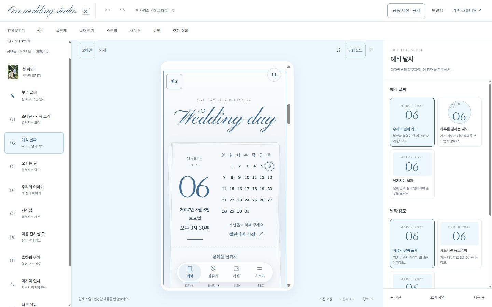
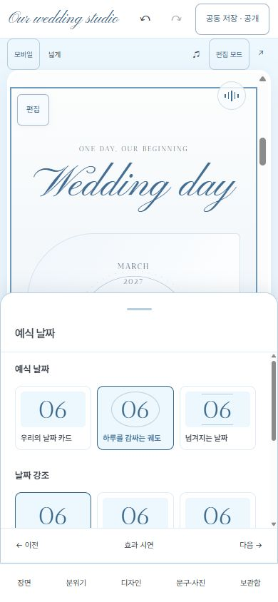

# Studio V2 구현과 검증

2026년 11월 1일. [Studio V2](https://sungso-wedding.vercel.app/lab/studio-v2/)는 기존 두 회원 로그인으로 사용하는 별도 편집기다. 기존 V1과 하객용 VER5.6·VER6를 보존한다. 이번 범위는 승인한 계획의 0~2단계와 보호된 V2 경로 배포다.

## 사용할 수 있는 편집

- 왼쪽 장면 목록, 중앙 실제 청첩장, 오른쪽 디자인·문구·크기/간격 설정을 함께 표시한다.
- 전체 색감·글씨체·크기·사진 톤·스크롤·여백을 변경해도 읽던 장면을 유지한다. 장면 선택·이전/다음은 해당 위치로 이동하고 장면 옵션은 실제 시연을 재사용한다.
- 초대 문구·가족 이름·이야기·마지막 인사와 사진을 같은 설정에서 편집한다. 지원 문구는 미리보기에서 두 번 눌러 직접 편집할 수 있다.
- 순서는 드래그, 위/아래, 위치 선택으로 바꾼다. 필수7개는 유지하고 선택 장면은 필요한 항목만 추가·제외한다.
- 기준 고정은 디자인·문구·사진 전체를 보관한다. 비교 중에도 저장할 현재 조합과 URL은 바뀌지 않는다. 되돌리기와 다시 실행은 전체 초안을 대상으로 한다.
- 기존40개 디자인 보관함·별점·메모와 형식1 URL/파일을 유지한다. 디자인 파일을 불러올 때 현재 문구와 사진은 유지한다. 새 전체 파일은 문구·사진도 포함한다.
- V2 작업 문구/사진은 별도 IndexedDB에 보관하며 V1 초안은 자동 덮어쓰지 않는다. 공동 초안 저장·충돌 처리·공개/복원은 기존 서버를 사용한다. 공개는 사용자가 별도로 확인해야 한다.
- 모바일은 장면 목록과 분위기 메뉴, 높이를 바꿀 수 있는 하단 설정 패널을 제공한다.

## 화면

## 검증 결과

| 범위 | 확인한 결과 |
| --- | --- |
| 자동 검사 | 전체2,537개 통과, 사이트 빌드·정적 참조/구문 검사 통과 |
| 문구·사진 | 직접 초대 문구 편집과 되돌리기, 사진7→8장 추가 및 로컬 저장 |
| 저장 | 합성 서버에 이름·메모가 있는 공동 초안 저장, 저장 전후 하객 공개본은 기존 상태 유지 |
| 조합 | 기존 URL/형식과40개 별점/메모 회귀, 기준 비교가 현재 URL을 변경하지 않음, 순서 변경·복구·이전/다음 |
| 미디어 | 음악 재생 중 폰트 변경 후 시간이 이어짐, 직접 정지 후 색감 변경해도 정지 유지 |
| 반응형 | 320/390/430/1100/1440px 가로 넘침0, 모바일 모든 전체 분위기 설정과 비교 접근 |
| 운영 접근 | 익명 V1/V2 HTML은303 로그인 이동, V2 소스/관리 API는401, 로그인된 기존 회원으로 V2 진입 |
| 운영 보존 | 루트·VER6·음악·대표 사진 SHA-256 동일, 다른 앱3개 경로404, 공개 자산204개 보존 |

운영 초안·계좌·앨범·방명록에는 테스트 데이터를 쓰지 않았다. V1 이전 번들5개의 생성 경로 주석과 보호 파일 목록은 새 출력 디렉터리에 맞게 달라지며 기능 코드는 유지된다. 배포 ID는 `dpl_39JDRvJGryxiX9R8HnoiqBwgmBjc`다. 익명 HTTP 결과는 `live-check.json`에 보관했다.

운영 첫 로드에서 미리보기가 먼저 준비될 때 연결 신호를 놓치는 문제를 확인해 V2 전용 준비 확인 메시지로 수정했다. 부모/동일 출처 검사와 독립 하객 화면 제외를 유지하며 운영 재로딩 후 날짜 이동·공동 보관함 조회·오류0을 확인했다.

## 남은 범위

필름형 사진첩·폴라로이드 방명록·영수증형 패스 등 신규 하객 표현과 영상/음성/퀴즈는 후속 단계다. 이번에 전체15종이 추가된 것은 아니다. iOS Safari·Android Chrome·카카오톡 실물 기기, 한글 IME 전체 조합과 모든 선택 조합의 프레임 성능은 별도 확인 대상이다. 실제 계좌/예식 정보 관리와 회원 권한은 기존 화면·서버를 유지한다.

**다음:** V2에서 실제 공동 초안을 선택해 사용성을 확인하고, 신규 하객 표현을 한 가지씩 추가한다.
